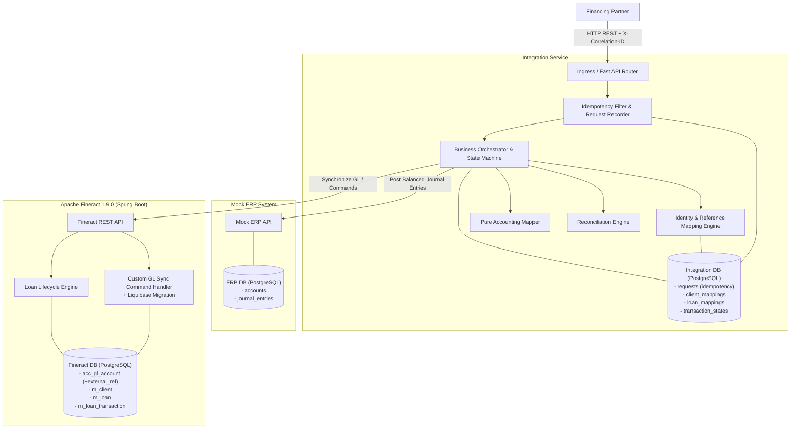
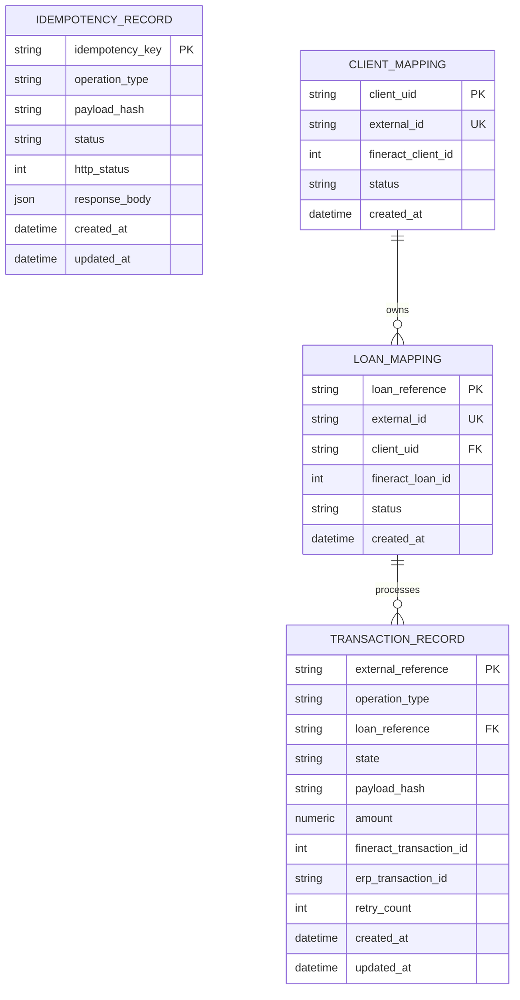
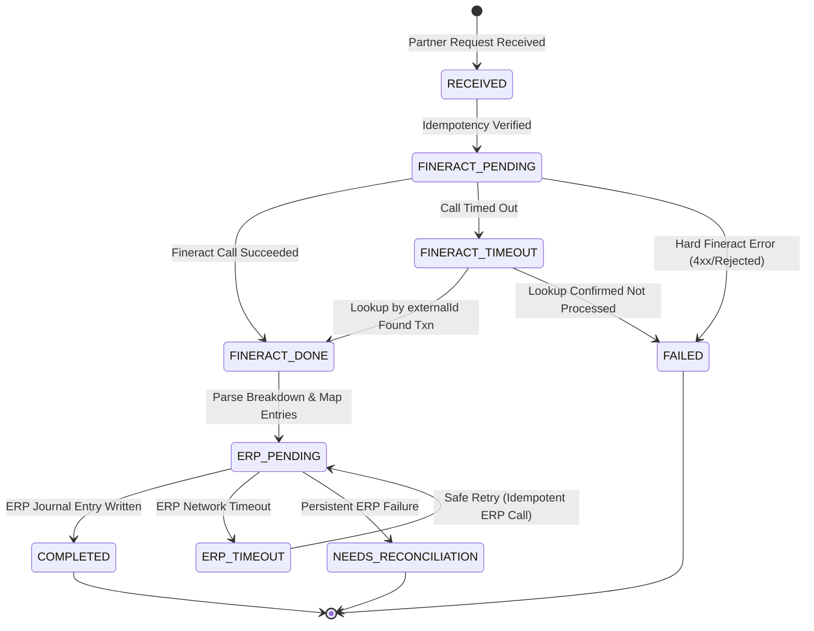

# Architecture Specification

## 1. System Overview & Component Topology

The system integrates Apache Fineract (Core Banking) with a Mock ERP (Accounting Master) via a resilient, idempotent Python Integration Service.

---

## 2. Core Components

### 2.1 Mock ERP (Accounting Master)
* **Role:** Owns the Chart of Accounts (COA) and general ledger balances.
* **Responsibilities:**
  - Seeds and exposes master accounts (`1100 Bank`, `1200 Loan Receivable`, `4000 Interest Income`).
  - Records balanced double-entry journal entries ($\sum \text{Debits} == \sum \text{Credits}$).
  - Enforces independent idempotency on `external_reference`.

### 2.2 Apache Fineract (Core Banking System of Record)
* **Role:** System of record for borrowers, loans, repayment schedules, disbursements, and repayments.
* **Customization (Part A):**
  - Extended GL account entity and database schema with `external_reference` (via Liquibase migration).
  - Synchronizes accounts idempotently: returns HTTP 200 for identical payload; returns HTTP 409 Conflict for different payload with the same reference.

### 2.3 Integration Service (Orchestrator)
* **Role:** Mediates partner interactions, encapsulates Fineract internal IDs, manages distributed transaction lifecycles, and guarantees financial invariants.
* **Key Modules:**
  - **Identity Mapping:** Maps `client_uid` and `loan_reference` to Fineract `externalId` (internal numeric IDs never cross service boundaries).
  - **Idempotency Engine:** Prevents double-processing using database-level locking and unique constraints.
  - **Accounting Mapper:** A pure, side-effect-free function translating Fineract transaction breakdowns into ERP journal entries.
  - **Reconciliation Service:** Matches core banking transactions against ERP journal entries.

---

## 3. Data Model & Identity Boundaries

External consumers operate strictly with business identifiers. The integration database maintains bidirectional mappings:

### 3.1 Integration Database Schema

---

## 4. Distributed Transaction State Machine

Every financial mutation (Disbursement, Repayment) executes as an explicit, persisted state machine:

### State Definitions
1. **`RECEIVED`**: Ingress payload validated and recorded in DB with initial status `IN_PROGRESS`.
2. **`FINERACT_PENDING`**: Request sent to Fineract with `externalId = external_reference`.
3. **`FINERACT_DONE`**: Fineract returned transaction ID, or lookup resolved that Fineract processed it.
4. **`ERP_PENDING`**: Fineract transaction breakdown retrieved; journal entry submitted to Mock ERP.
5. **`COMPLETED`**: Journal entry confirmed by Mock ERP. Response returned to client.
6. **`FAILED`**: Explicit business failure or unrecoverable validation error.
7. **`NEEDS_RECONCILIATION`**: Inconsistency detected requiring manual or automated reconciliation sweep (e.g., Fineract succeeded but ERP remains down after max retries).

---

## 5. GL Synchronization Design (Part A)

### 5.1 Synchronization Flow
1. ERP Account created: `POST /api/accounts` with `{ code: "1200", external_reference: "GL-1200", ... }`.
2. Sync trigger forwards request to Integration Service: `POST /api/accounts/sync`.
3. Integration Service maps ERP types (`ASSET`, `LIABILITY`, `EQUITY`, `INCOME`, `EXPENSE`) to Fineract GL type integers.
4. Fineract evaluates `external_reference`:
   * **New reference:** Persists new GL account with `external_reference`.
   * **Existing reference + Identical attributes:** Returns existing GL account entity (`HTTP 200`).
   * **Existing reference + Conflicting attributes:** Rejects with `HTTP 409 Conflict`.
5. Fineract permissions model guards the endpoint (`CREATE_GLACCOUNT`).

