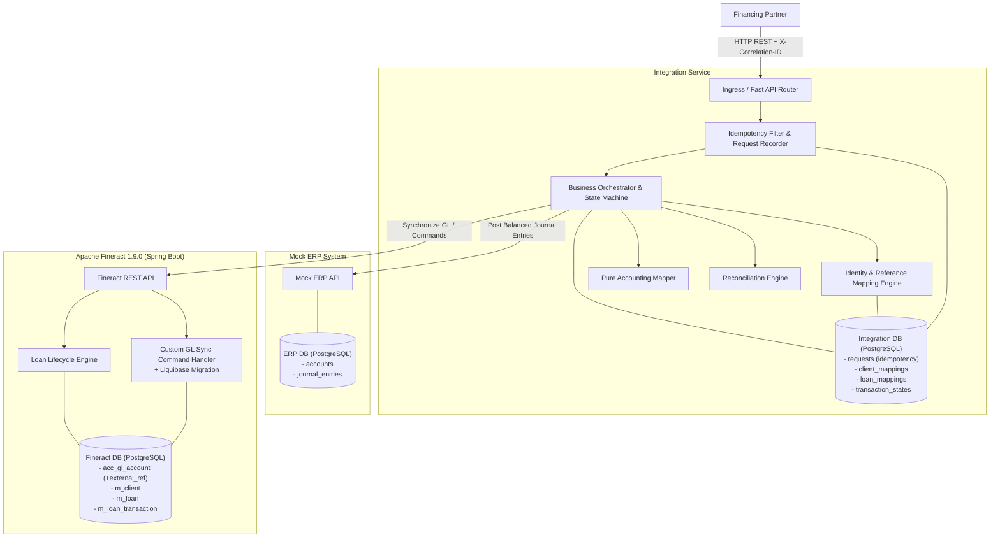
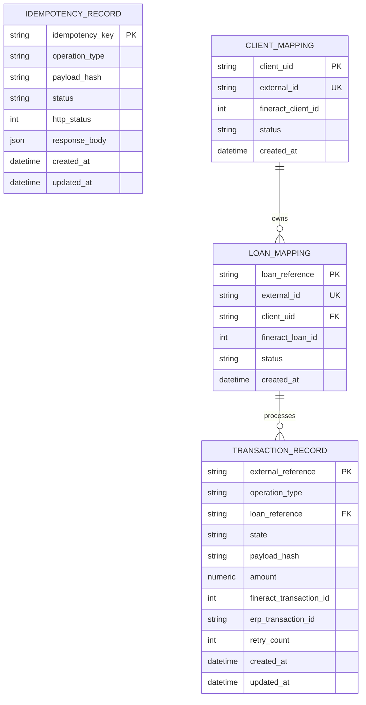
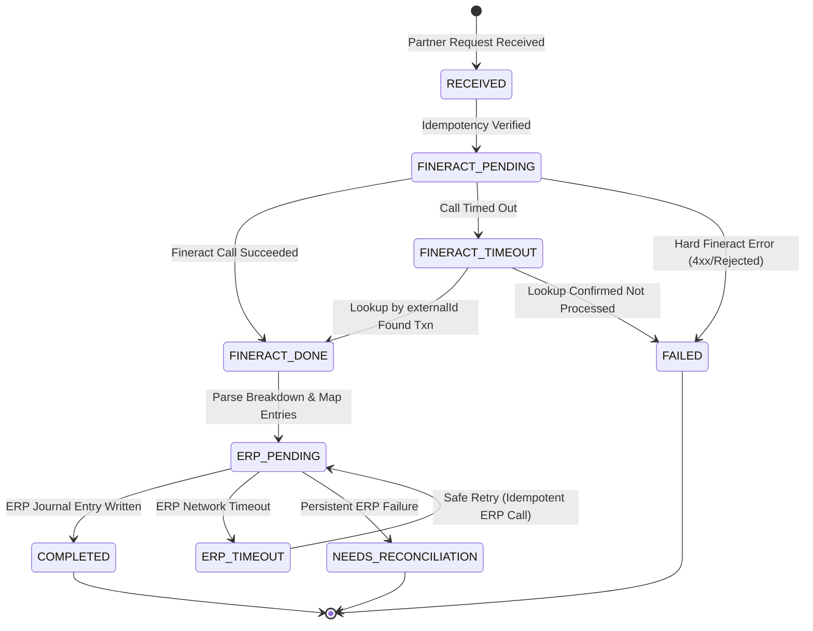
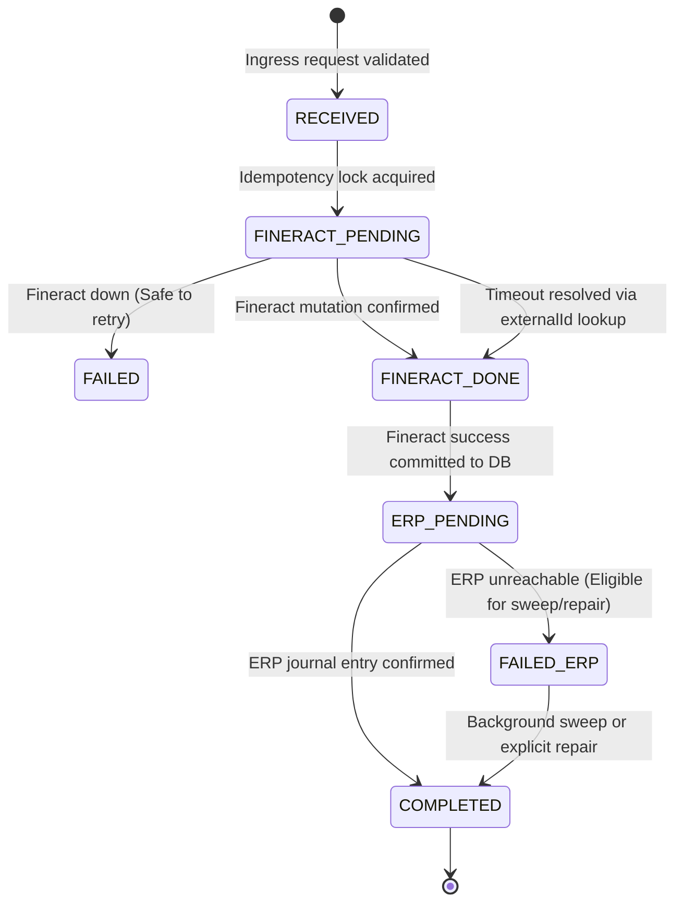
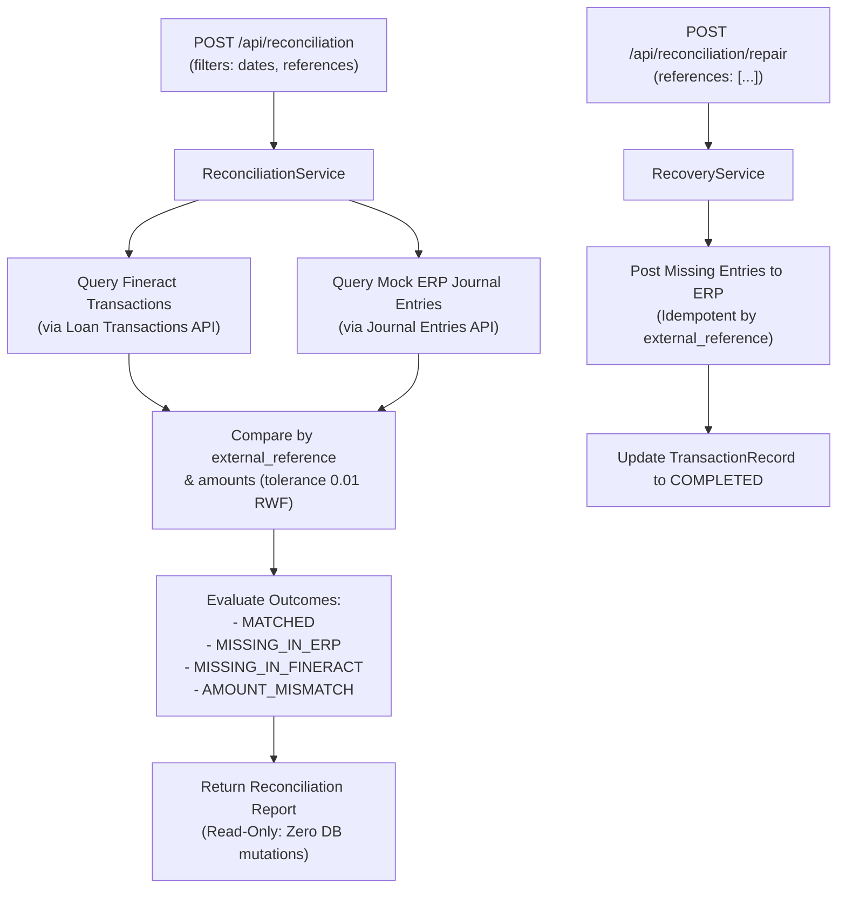

# Architecture Specification

## 1. System Overview & Component Topology

The system integrates Apache Fineract (Core Banking) with a Mock ERP (Accounting Master) via a resilient, idempotent Python Integration Service.

---

## 2. Core Components

### 2.1 Mock ERP (Accounting Master)
* **Role:** Owns the Chart of Accounts (COA) and general ledger balances.
* **Responsibilities:**
  - Seeds and exposes master accounts (`1100 Bank`, `1200 Loan Receivable`, `4000 Interest Income`).
  - Records balanced double-entry journal entries ($\sum \text{Debits} == \sum \text{Credits}$).
  - Enforces independent idempotency on `external_reference`.

### 2.2 Apache Fineract (Core Banking System of Record)
* **Role:** System of record for borrowers, loans, repayment schedules, disbursements, and repayments.
* **Customization (Part A):**
  - Extended GL account entity and database schema with `external_reference` (via Liquibase migration).
  - Synchronizes accounts idempotently: returns HTTP 200 for identical payload; returns HTTP 409 Conflict for different payload with the same reference.

### 2.3 Integration Service (Orchestrator)
* **Role:** Mediates partner interactions, encapsulates Fineract internal IDs, manages distributed transaction lifecycles, and guarantees financial invariants.
* **Key Modules:**
  - **Identity Mapping:** Maps `client_uid` and `loan_reference` to Fineract `externalId` (internal numeric IDs never cross service boundaries).
  - **Idempotency Engine:** Prevents double-processing using database-level locking and unique constraints.
  - **Accounting Mapper:** A pure, side-effect-free function translating Fineract transaction breakdowns into ERP journal entries.
  - **Reconciliation Service:** Matches core banking transactions against ERP journal entries.

---

## 3. Data Model & Identity Boundaries

External consumers operate strictly with business identifiers. The integration database maintains bidirectional mappings:

### 3.1 Integration Database Schema

---

## 4. Distributed Transaction State Machine

Every financial mutation (Disbursement, Repayment) executes as an explicit, persisted state machine:

### State Definitions
1. **`RECEIVED`**: Ingress payload validated and recorded in DB with initial status `IN_PROGRESS`.
2. **`FINERACT_PENDING`**: Request sent to Fineract with `externalId = external_reference`.
3. **`FINERACT_DONE`**: Fineract returned transaction ID, or lookup resolved that Fineract processed it.
4. **`ERP_PENDING`**: Fineract transaction breakdown retrieved; journal entry submitted to Mock ERP.
5. **`COMPLETED`**: Journal entry confirmed by Mock ERP. Response returned to client.
6. **`FAILED`**: Explicit business failure or unrecoverable validation error.
7. **`NEEDS_RECONCILIATION`**: Inconsistency detected requiring manual or automated reconciliation sweep (e.g., Fineract succeeded but ERP remains down after max retries).

### 4.2 Retry Policy, Allowed Transitions & Recovery Rules
* **Allowed Transitions:**
  * `RECEIVED` $\to$ `FINERACT_PENDING` | `FAILED`
  * `FINERACT_PENDING` $\to$ `FINERACT_DONE` | `ERP_PENDING` | `FAILED`
  * `FINERACT_DONE` $\to$ `ERP_PENDING` | `COMPLETED`
  * `ERP_PENDING` $\to$ `COMPLETED` | `NEEDS_RECONCILIATION`
  * `NEEDS_RECONCILIATION` $\to$ `COMPLETED` | `FAILED`
* **What is Safe to Retry:**
  * **Mutation to Fineract:** Never blindly retried! When a timeout occurs on a Fineract mutation, the service queries `find_transaction_by_external_id`. Only if confirmed missing is the transaction marked `FAILED`, allowing the caller to safely retry.
  * **Posting to Mock ERP:** Safe to retry indefinitely. Because Mock ERP enforces uniqueness on `external_reference`, replaying the journal entry is completely idempotent and will never create duplicate ledger entries.
* **Retry Policy:**
  * Exponential backoff ($1\text{s}, 2\text{s}, 4\text{s}$) with jitter. Max automated attempts = 3.
  * If max retries are exhausted while ERP remains unreachable, the transaction is marked `NEEDS_RECONCILIATION` and surfaces in the reconciliation report.
* **Worker-less Crash Recovery:**
  * State transitions and Fineract transaction IDs are committed to PostgreSQL *before* initiating the HTTP call to ERP.
  * On application startup or via `POST /api/transactions/recover`, the recovery sweeper scans all transactions in `ERP_PENDING` / `NEEDS_RECONCILIATION` and posts them to Mock ERP idempotently, completing interrupted operations without requiring an external queue or background worker.

---

## 5. GL Synchronization Design (Part A)

### 5.1 Synchronization Flow
1. ERP Account created: `POST /api/accounts` with `{ code: "1200", external_reference: "GL-1200", ... }`.
2. Sync trigger forwards request to Integration Service: `POST /api/accounts/sync`.
3. Integration Service maps ERP types (`ASSET`, `LIABILITY`, `EQUITY`, `INCOME`, `EXPENSE`) to Fineract GL type integers.
4. Fineract evaluates `external_reference`:
   * **New reference:** Persists new GL account with `external_reference`.
   * **Existing reference + Identical attributes:** Returns existing GL account entity (`HTTP 200`).
   * **Existing reference + Conflicting attributes:** Rejects with `HTTP 409 Conflict`.
5. Fineract permissions model guards the endpoint (`CREATE_GLACCOUNT`).

---

## 6. Pure Accounting Mapping & Ledger Derivation (Part H)

### 6.1 Pure Function Guarantee
The mapping from core banking events to double-entry general ledger journal entries is implemented as a **pure function** (`derive_journal_entries_from_breakdown` in `app/services/accounting.py`):
- **Deterministic:** The exact same input parameters always produce the exact same journal lines.
- **Zero Side Effects:** Does not interact with databases, network sockets, file systems, or global state.
- **Independently Unit-Testable:** Validated in `tests/test_accounting.py` without requiring mocks, stubs, or running servers.

### 6.2 Ledger Mapping Rules

| Event / Operation Type | Debit Accounts | Credit Accounts | Invariant Verified |
| :--- | :--- | :--- | :--- |
| **`DISBURSEMENT`** | `DR 1200` Loan Receivable (Principal) | `CR 1100` Bank Account (Disbursed Amount) | $\sum DR = \sum CR = \text{Amount}$ |
| **`DISBURSEMENT_REVERSAL`** | `DR 1100` Bank Account | `CR 1200` Loan Receivable | Exact inversion of disbursement lines |
| **`REPAYMENT`** (Standard) | `DR 1100` Bank Account (Total Cash Paid) | `CR 1200` Loan Receivable (Principal Portion) `CR 4000` Interest Income (Interest Portion) | $\text{Cash} = \text{Principal} + \text{Interest}$ |
| **`REPAYMENT`** (With Fees/Penalties) | `DR 1100` Bank Account | `CR 1200` Principal `CR 4000` Interest `CR 4100` Fee Income `CR 4200` Penalty Income | Cash equals sum of all portions |
| **`REPAYMENT`** (With Overpayment) | `DR 1100` Bank Account | `CR 1200` Principal `CR 4000` Interest `CR 2100` Customer Overpayment Liability | Unallocated cash recognized as liability |
| **`REPAYMENT_REVERSAL`** | `DR 1200` Principal `DR 4000` Interest | `CR 1100` Bank Account | Exact inversion preserving historical ledger |

### 6.3 Breakdown Source: Single Source of Truth
- **Assessment Question:** *Where does the principal/interest split come from? Does Fineract provide it, does the integration service calculate it, or does the ERP?*
- **Architecture Answer:** **Fineract core banking engine is the authoritative single source of truth.**
  1. The integration service never calculates amortization or interest splits locally, eliminating rounding discrepancies or schedule drift.
  2. When a repayment is submitted via `POST /loans/{loanId}/transactions?command=repayment`, Fineract's schedule engine applies its configured allocation strategy (e.g., Penalties $\to$ Fees $\to$ Interest $\to$ Principal).
  3. The integration service fetches the precise breakdown from Fineract via `GET /loans/{loanId}/transactions/{transactionId}`, extracting:
     - `principalPortion`
     - `interestPortion`
     - `feeChargesPortion`
     - `penaltyChargesPortion`
     - `unrecognizedAmount`
  4. The pure mapping function consumes this exact breakdown to construct the balanced ERP journal entry.

### 6.4 Handling Overpayments
When a borrower pays more than the total outstanding balance:
1. Fineract allocates payments up to total outstanding obligations and flags the excess in transaction breakdown or loan overpayment summary.
2. In the pure accounting function, if `total_amount > (principal + interest + fee + penalty)`, the excess is credited to Account `2100` (`Customer Overpayment Liability`).
3. This ensures:
   - Ledgers remain perfectly balanced ($\sum \text{Debits} = \sum \text{Credits}$).
   - The institution correctly reflects a liability owed back to the customer rather than incorrectly inflating income or over-amortizing receivables.

### 6.5 Handling Reversals
When an erroneous disbursement or repayment is reversed in Fineract:
1. Fineract marks the original transaction entity with `manuallyReversed: true`.
2. To preserve an immutable accounting audit trail, previously posted ERP journal entries are **never deleted or modified**.
3. Instead, the integration service invokes the pure accounting function with `DISBURSEMENT_REVERSAL` or `REPAYMENT_REVERSAL`.
4. The function outputs compensating journal lines that mirror the original debits and credits in reverse, restoring the account balances to their correct state.

---

## 7. Loan Lifecycle & Invariant Protection (Part D)

### 7.1 End-to-End Lifecycle Stages
The integration service supports the full 6-phase loan lifecycle:
1. **Client Creation:** Partner calls `POST /api/clients` with `client_uid` (e.g. `SME-000001`). Mapped to Fineract `externalId`.
2. **Loan Application:** Partner calls `POST /api/loans` with `loan_reference` (e.g. `LN-2026-000001`), `principal=5,000,000 RWF`, `term_months=12`, `interest_rate=18.0`. Initial state: `SUBMITTED_AND_PENDING_APPROVAL`.
3. **Loan Approval:** Partner or workflow calls `POST /api/loans/{loan_reference}/approve`. Loan transitions to `APPROVED`.
4. **Loan Disbursement:** Partner calls `POST /api/loans/{loan_reference}/disburse`. Fineract disburses loan (`ACTIVE`), and ERP journal entry is posted (`DR 1200 / CR 1100`).
5. **Partial Repayments:** Partner submits at least 3 partial repayments via `POST /api/loans/{loan_reference}/repayments`. Each transaction derives actual principal/interest from Fineract and posts balanced lines to ERP.
6. **Final Payoff & Close:** Payoff transaction clears outstanding balance. Fineract automatically closes the loan with status `Closed (obligations met)`.

### 7.2 Single-Disbursement Invariant Enforcement
To guarantee a loan can never be disbursed more than once:
1. **Integration Layer Check:** `LoanMapping.disbursed == 1` causes immediate rejection with `HTTP 409 Conflict`.
2. **Database Unique Constraint:** Unique index on `transaction_records(loan_reference)` where `operation_type = 'DISBURSEMENT'`.
3. **Core Banking Engine Validation:** Fineract rejects disbursement commands on loans that are no longer in `APPROVED` status.

---

## 8. Failure Handling & Distributed State Recovery (Part J)

### 8.1 Transaction State Machine
Distributed financial operations advance through an explicit persisted state machine in PostgreSQL:

### 8.2 Recovery Mechanics Without Worker Queue
1. **Database-Committed Checkpoints:** Before calling Mock ERP over the network, the Fineract transaction ID and breakdown are committed to PostgreSQL (`state: ERP_PENDING`).
2. **Crash Resilience:** If the application process crashes, restarts, or loses power between Fineract success and ERP posting, the startup recovery sweep (`run_startup_recovery`) detects uncompleted `ERP_PENDING` records.
3. **Lookup-Before-Retry:** Network timeouts to Fineract never trigger blind re-submissions. The service queries Fineract by `externalId`. If the transaction exists, it proceeds directly to ERP posting.
4. **ERP-Side Idempotency:** When the recovery sweeper replays entries to Mock ERP, ERP recognizes duplicate `external_reference` values and returns the existing journal entry without re-posting.

---

## 9. Concurrency Architecture & Defense-in-Depth (Part I)

### 9.1 Multi-Layer Defense Matrix

| Layer | Component | Mechanism | Protection Scope |
| :--- | :--- | :--- | :--- |
| **Layer 1** | Ingress Idempotency Filter | `idempotency_records` table check | Filters sequential duplicates and in-flight identical requests |
| **Layer 2** | Relational Database Locks & Constraints | PostgreSQL `disbursement_records(loan_reference)` PK | Atomically rejects concurrent disbursement races with `409 Conflict` |
| **Layer 3** | Core Banking External ID | Fineract `externalId` uniqueness constraint | Prevents duplicate transaction insertion within core banking |
| **Layer 4** | Core Loan State Machine | Fineract `m_loan.loan_status_id` validation | **Last line of defence**: Enforces loan must be `APPROVED` to disburse |

---

## 10. Two-Way Transaction Reconciliation Engine (Part K)

### 10.1 Engine Architecture
The reconciliation engine performs an independent two-way comparison between Fineract loan transactions and Mock ERP general ledger journal entries:

### 10.2 Discrepancy Classification
1. **`MATCHED`:** Confirmed in both systems; amounts match within 0.01 RWF tolerance.
2. **`MISSING_IN_ERP`:** Fineract loan transaction exists (`fineract_transaction_id` recorded), but no matching entry exists in ERP.
3. **`MISSING_IN_FINERACT`:** ERP journal entry exists, but no matching loan transaction exists in Fineract.
4. **`AMOUNT_MISMATCH`:** Present in both systems, but amounts differ beyond 0.01 tolerance ($\Delta = \text{Amount}_{\text{ERP}} - \text{Amount}_{\text{Fineract}}$).
5. **Reversal Handling:** Reversed Fineract transactions (`manuallyReversed: true`) are paired with ERP compensating reversal journal entries (`DISBURSEMENT_REVERSAL` or `REPAYMENT_REVERSAL`), confirming net zero financial impact.

---

## 11. Observability Architecture & Correlated Logging (Section 9)

### 11.1 Structured JSON Logging
All application logs are emitted as single-line structured JSON to `stdout` containing the mandatory correlation context:
* `timestamp`: ISO-8601 UTC timestamp.
* `correlation_id`: Distributed trace UUID passed via `X-Correlation-ID` header.
* `external_reference`: Business transaction idempotency key.
* `client_uid`: External client business identifier.
* `loan_reference`: External loan business identifier.
* `fineract_transaction_id`: Internal Fineract transaction identifier (when available).
* `erp_transaction_id`: Mock ERP journal entry identifier (when available).
* `status`: Current state machine step (`RECEIVED`, `FINERACT_PENDING`, `FINERACT_DONE`, `ERP_PENDING`, `COMPLETED`, `FAILED`).
* `message`: Human-readable log narrative.

